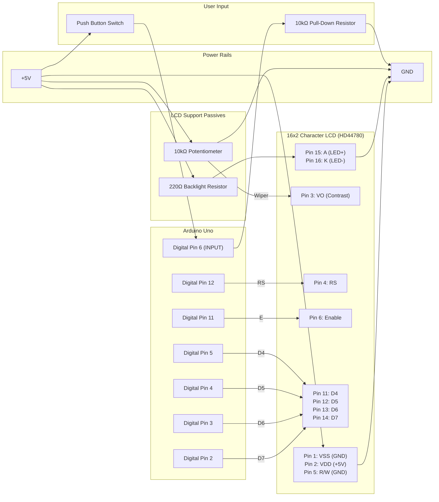

# Arduino LCD Racing Car

A two-lane side-scrolling obstacle-avoidance racing game running on an Arduino with a 16x2 character LCD display and a single push button.

* **Source Code:** [`racing_car.ino`](racing_car.ino)
* **Video Demo:** [YouTube](https://www.youtube.com/watch?v=AaIZ4X26AM8)

---

## How It Works

1. **Display & Controls:**
   * The player's car (`>`) is positioned at column `0` of the 16x2 LCD screen (either top row `0` or bottom row `1`).
   * Pressing the push button on **Digital Pin 6** starts the game from the title screen (`Ready? / Press to start`), switches the car between the top and bottom lanes while driving, or restarts the game after a crash (`Car crashed... / Press to restart`).
2. **Scrolling & Obstacles:**
   * Obstacles (`O`) spawn randomly in column `15` on either the top or bottom row and shift left by one column each frame.
   * The game prevents impossible-to-pass diagonal blocks: if an obstacle is present at column `14` on one row, column `15` on the opposite row is guaranteed to be clear.
   * Initial frame interval is `300 ms` and accelerates by `20 ms` every 10 frames down to `200 ms`.
   * Serial output (`9600` baud) logs the 2x16 scene buffer on every frame update.

---

## Bill of Materials (Components)

> [!IMPORTANT]
> **Every part below is included in the [Official Arduino Starter Kit (K000007)](https://store.arduino.cc/products/arduino-starter-kit-multi-language).**
> No extra purchases are needed. The quantities in the "In Starter Kit" column come from the kit's official contents list.

| Component | Qty Needed | In Starter Kit (K000007) | Purpose |
| :--- | :---: | :---: | :--- |
| **Arduino Uno Rev3** | 1 | ✅ 1x Arduino Uno | Microcontroller running the game loop |
| **16x2 Character LCD** (kit part: JHD659 M10, SPLC780D controller — HD44780 compatible) | 1 | ✅ 1x alphanumeric LCD (16x2 characters) | 2-row x 16-column game display |
| **Pushbutton** (4-leg tactile switch) | 1 | ✅ 10x Pushbuttons | Start, restart, and lane-switching input |
| **10kΩ Potentiometer** | 1 | ✅ 3x Potentiometer 10kΩ | LCD contrast adjustment (`V0`, Pin 3) |
| **10kΩ Resistor** (brown-black-orange) | 1 | ✅ 20x Resistors 10kΩ | Pull-down resistor for the pushbutton on Pin 6 |
| **220Ω Resistor** (red-red-brown) | 1 | ✅ 20x Resistors 220Ω | Current-limiting resistor for LCD LED backlight (`LEDA`, Pin 15) |
| **Breadboard** (400 points) | 1 | ✅ 1x Breadboard 400 points | Circuit assembly |
| **Solid-core jumper wires** | ~20 | ✅ 70x Solid core jumper wires | Connections |
| **USB cable** | 1 | ✅ 1x USB cable | Programming and 5V power |

*Not needed from the kit:* the tilt sensor, LEDs, motors, transistors, capacitors, etc.

### Verified Against the Starter Kit Projects Book

This sketch is a direct descendant of **Project 11 – Crystal Ball** from the kit's *Arduino Projects Book*. The LCD constructor `LiquidCrystal lcd(12, 11, 5, 4, 3, 2);`, the input pin `const int switchPin = 6;`, and the `switchState` / `prevSwitchState` edge-detection variables are identical to the official `p11_CrystalBall` example, whose stated parts list is *"220 ohm resistor, 10 kilohm resistor, 10 kilohm potentiometer, 16x2 LCD screen, tilt switch."*

The **only hardware difference** is the input device: the game prompts `Press to start`, so the **tilt switch is replaced by one of the kit's pushbuttons**. Electrically a tilt switch and a pushbutton are both simple on/off switches, so the wiring is unchanged — it is the same pushbutton + 10kΩ pull-down circuit used in **Project 02 – Spaceship Interface**. (If you prefer, the kit's tilt switch can still be used in place of the pushbutton with no wiring changes; you would then tilt it instead of pressing.)

The LCD wiring (RS→12, E→11, D4→5, D5→4, D6→3, D7→2, R/W→GND, backlight via 220Ω, contrast via 10kΩ pot) is also exactly the circuit in Arduino's official [LiquidCrystal / LCD display guide](https://docs.arduino.cc/learn/electronics/lcd-displays/), and the pin numbering below (1 = `VSS` … 16 = `LEDK`) matches the [datasheet of the kit's LCD](https://content.arduino.cc/assets/LCDscreen.PDF) (JHD659, section 14 "Interface").

---

## Circuit Description & Pinout Mapping

The circuit uses the standard Arduino `LiquidCrystal` 4-bit parallel interface (`LiquidCrystal lcd(12, 11, 5, 4, 3, 2);`) and an active-`HIGH` pushbutton on Digital Pin `6` (`const int switchPin = 6;`):

* **LCD Data & Control (4-bit Mode):**
  * **Register Select (`RS`, LCD Pin 4)** connects to **Arduino Pin 12**.
  * **Read/Write (`R/W`, LCD Pin 5)** is tied to **GND** (write-only mode).
  * **Enable (`E`, LCD Pin 6)** connects to **Arduino Pin 11**.
  * **Data Pins `D4`–`D7` (LCD Pins 11–14)** connect to **Arduino Pins 5, 4, 3, and 2**, respectively.
  * **Data Pins `D0`–`D3` (LCD Pins 7–10)** are left unconnected.
* **LCD Power, Contrast, and Backlight:**
  * **Power (`VSS` Pin 1, `VDD` Pin 2):** `VSS` goes to **GND** and `VDD` goes to **+5V**.
  * **Contrast (`VO` / `V0`, Pin 3):** Connects to the center wiper of the **10kΩ potentiometer**, whose outer legs connect to **+5V** and **GND**. If the screen shows nothing or only solid blocks, turn this pot.
  * **Backlight (`A` Pin 15, `K` Pin 16):** Anode (`A`) connects to **+5V** through a **220Ω resistor**; Cathode (`K`) connects to **GND**. (The kit's JHD659 module already has an on-board 110Ω backlight resistor, so the 220Ω — which the Projects Book also uses — simply makes the backlight a bit dimmer and is a safe choice.)
* **Pushbutton (Active-HIGH Input):**
  * Because `pinMode(switchPin, INPUT)` is used and presses are triggered on the rising edge (`switchState == HIGH`), one side of the button connects to **+5V** and the other side connects to **Arduino Digital Pin 6** with a **10kΩ pull-down resistor** to **GND** (holding Pin 6 at `LOW` when released).
  * The kit's pushbuttons have **4 legs**. Seat the button straddling the breadboard's center channel and connect **+5V** and the **Pin 6 / 10kΩ node** to two **diagonally opposite** legs — that works in any orientation. If the game never reacts (or behaves as if the button were held down), rotate the button 90°.

### Complete Pin Mapping Table

Pin numbers and symbols follow the kit LCD's datasheet (JHD659, section 14 "Interface"). Pin 1 is the end of the 16-pin header closest to the corner marked `1` / `VSS` on the module.

| 16x2 LCD / Component Pin | Function | Arduino / Power Connection |
| :--- | :--- | :--- |
| **LCD Pin 1 (`VSS`)** | Ground | `GND` |
| **LCD Pin 2 (`VDD`)** | +5V Logic Supply | `+5V` |
| **LCD Pin 3 (`V0` / `VO`)** | Contrast Adjustment | Center wiper of **10kΩ Potentiometer** (outer pins to `+5V` and `GND`) |
| **LCD Pin 4 (`RS`)** | Register Select | **Digital Pin 12** |
| **LCD Pin 5 (`R/W`)** | Read / Write Select | `GND` (Write mode) |
| **LCD Pin 6 (`E`)** | Enable | **Digital Pin 11** |
| **LCD Pins 7–10 (`DB0`–`DB3`)** | Low-Order Data Bus | *Not Connected (4-bit mode)* |
| **LCD Pin 11 (`DB4`)** | Data Line 4 | **Digital Pin 5** |
| **LCD Pin 12 (`DB5`)** | Data Line 5 | **Digital Pin 4** |
| **LCD Pin 13 (`DB6`)** | Data Line 6 | **Digital Pin 3** |
| **LCD Pin 14 (`DB7`)** | Data Line 7 | **Digital Pin 2** |
| **LCD Pin 15 (`LEDA` / `A` / `LED+`)** | Backlight Anode (+) | `+5V` through **220Ω Resistor** |
| **LCD Pin 16 (`LEDK` / `K` / `LED-`)** | Backlight Cathode (-) | `GND` |
| **Pushbutton Leg A** | Switch Supply | `+5V` |
| **Pushbutton Leg B** (diagonally opposite Leg A) | Switch Signal Output | **Digital Pin 6** + **10kΩ Pull-Down Resistor** to `GND` |

### Step-by-Step Breadboard Assembly (Starter Kit Parts)

> [!WARNING]
> Unplug the USB cable while wiring. Double-check that `+5V` and `GND` never touch each other.

1. **Power rails:** Jumper the Arduino's `5V` pin to the breadboard's red (`+`) rail and `GND` to the blue (`−`) rail.
2. **LCD:** Plug the LCD's 16-pin header into one long row of the breadboard so each pin sits in its own column. Then wire:
   * Pin 1 `VSS` → `−` rail, Pin 2 `VDD` → `+` rail, Pin 5 `R/W` → `−` rail, Pin 16 `LEDK` → `−` rail.
   * Pin 15 `LEDA` → one end of the **220Ω** resistor; other end of the resistor → `+` rail.
3. **Contrast potentiometer:** Place the **10kΩ pot** in the breadboard. Outer legs → `+` rail and `−` rail; middle leg (wiper) → LCD Pin 3 `V0`.
4. **LCD signal wires (six jumpers):** Pin 4 `RS` → Arduino `12`, Pin 6 `E` → `11`, Pin 11 `DB4` → `5`, Pin 12 `DB5` → `4`, Pin 13 `DB6` → `3`, Pin 14 `DB7` → `2`. Leave Pins 7–10 empty.
5. **Pushbutton:** Press the 4-leg button across the breadboard's center channel. Jumper one leg → `+` rail. From the **diagonally opposite** leg, run a jumper to Arduino `6` **and** one end of the **10kΩ** resistor; other end of the resistor → `−` rail.
6. **Upload & tune:** Connect USB, upload [`racing_car.ino`](racing_car.ino) with the board set to *Arduino Uno*. If the LCD is blank or shows 16 solid blocks, turn the potentiometer until `Ready? / Press to start` appears. Open the Serial Monitor at `9600` baud to see the scene buffer printed every frame.

---

## Schematic Diagrams

### Visual Schematic


### ASCII Wiring Diagram

```text
                               +5V RAIL
   +----------------------+--------+-----------------------+
   |                      |        |                       |
   |                      |     +--+--+                 +--+--+
   |                      |     | 10k | (Outer legs     |220R |
   |                      |     | Pot |  to +5V & GND)  +--+--+
   |                      |     +--+--+                    |
   | 5V                   |        | (Wiper)               |
+--+-------------------+  +--------+-----------+           |
|                      |           |           |           |
|     ARDUINO UNO      |           v           v           v
|                      |     +-----+-----------+-----------+--+
|                  D12 +---->|  4:RS          3:VO   2:VDD 15:A|
|                  D11 +---->|  6:E                           |
|                   D5 +---->| 11:D4       16x2 LCD           |
|                   D4 +---->| 12:D5      (HD44780)           |
|                   D3 +---->| 13:D6                          |
|                   D2 +---->| 14:D7     [ >     O     O   ]  |
|                      |     |           [    O     O    O ]  |
|                      |     |  (Pins 7-10: D0-D3 unconnected)|
|                      |     |                1:VSS  5:R/W 16:K|
|                      |     +------------------+------+----+--+
|                      |                        |      |    |
|                   D6 +----+                   |      |    |
|                      |    |   Push Button     |      |    |
|  GND                 |    +----o/ o---> +5V   |      |    |
+--+-------------------+    |                   |      |    |
   |                      +-+-+                 |      |    |
   |                      |10k| Pull-down       |      |    |
   |                      +-+-+                 |      |    |
   |                        |                   |      |    |
   +------------------------+-------------------+------+----+
                               GND RAIL
```

### Block / Signal Flow Diagram (Mermaid)


