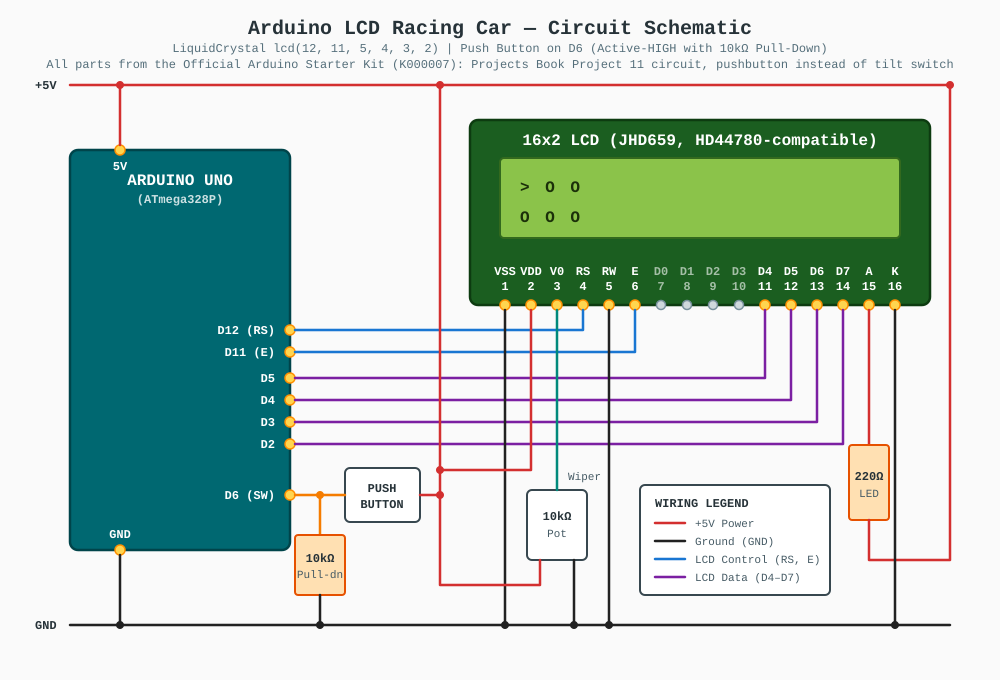
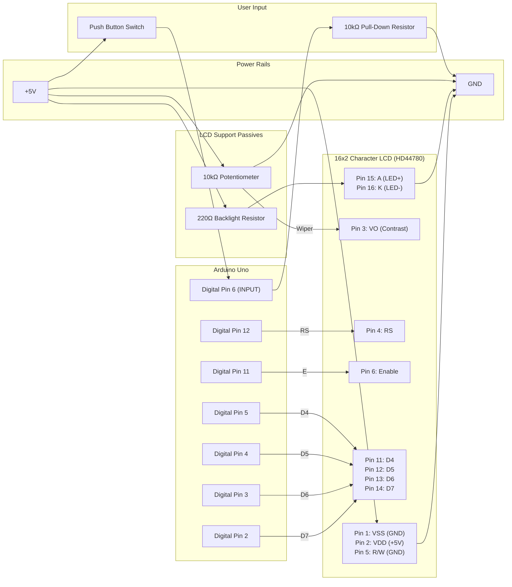

# Embedded Code [](https://github.com/wq2012/embedded/actions/workflows/ci.yml)

## Projects

### Arduino

* LCD racing car
  [[code](https://github.com/wq2012/embedded/blob/master/Arduino/LCD_racing_car/racing_car.ino)]
  [[demo](https://www.youtube.com/watch?v=AaIZ4X26AM8)]
  [[schematic](https://github.com/wq2012/embedded/blob/master/Arduino/LCD_racing_car/README.md)]

---

## LCD Racing Car — Schematic & Wiring Guide

A two-lane side-scrolling obstacle-avoidance racing game running on an Arduino with a 16x2 character LCD display and a single pushbutton.
The full build guide (step-by-step breadboard assembly, troubleshooting) lives in [`Arduino/LCD_racing_car/README.md`](Arduino/LCD_racing_car/README.md).

### Bill of Materials (Components)

> [!IMPORTANT]
> **Every part below is included in the [Official Arduino Starter Kit (K000007)](https://store.arduino.cc/products/arduino-starter-kit-multi-language).**
> No extra purchases are needed. The quantities in the "In Starter Kit" column come from the kit's official contents list.

| Component | Qty Needed | In Starter Kit (K000007) | Purpose |
| :--- | :---: | :---: | :--- |
| **Arduino Uno Rev3** | 1 | ✅ 1x Arduino Uno | Microcontroller running the game loop |
| **16x2 Character LCD** (kit part: JHD659 M10, SPLC780D controller — HD44780 compatible) | 1 | ✅ 1x alphanumeric LCD (16x2 characters) | 2-row x 16-column game display |
| **Pushbutton** (4-leg tactile switch) | 1 | ✅ 10x Pushbuttons | Start, restart, and lane-switching input |
| **10kΩ Potentiometer** | 1 | ✅ 3x Potentiometer 10kΩ | LCD contrast adjustment (`V0`, Pin 3) |
| **10kΩ Resistor** (brown-black-orange) | 1 | ✅ 20x Resistors 10kΩ | Pull-down resistor for the pushbutton on Pin 6 |
| **220Ω Resistor** (red-red-brown) | 1 | ✅ 20x Resistors 220Ω | Current-limiting resistor for LCD LED backlight (`LEDA`, Pin 15) |
| **Breadboard** (400 points) | 1 | ✅ 1x Breadboard 400 points | Circuit assembly |
| **Solid-core jumper wires** | ~20 | ✅ 70x Solid core jumper wires | Connections |
| **USB cable** | 1 | ✅ 1x USB cable | Programming and 5V power |

The circuit is the kit's *Arduino Projects Book* **Project 11 – Crystal Ball** circuit (same `LiquidCrystal lcd(12, 11, 5, 4, 3, 2)`, same `switchPin = 6`, same 220Ω / 10kΩ / 10kΩ-pot parts) with the **tilt switch swapped for a pushbutton** — the game says `Press to start`. The pushbutton + 10kΩ pull-down is the same arrangement as **Project 02 – Spaceship Interface**. The LCD wiring also matches Arduino's official [LCD display guide](https://docs.arduino.cc/learn/electronics/lcd-displays/), and the pin numbering matches the [kit LCD's datasheet](https://content.arduino.cc/assets/LCDscreen.PDF).

### Circuit Description & Pinout Mapping

The circuit uses the standard Arduino `LiquidCrystal` 4-bit parallel interface (`LiquidCrystal lcd(12, 11, 5, 4, 3, 2);`) and an active-`HIGH` pushbutton on Digital Pin `6` (`const int switchPin = 6;`):

* **LCD Data & Control (4-bit Mode):**
  * **Register Select (`RS`, LCD Pin 4)** connects to **Arduino Pin 12**.
  * **Read/Write (`R/W`, LCD Pin 5)** is tied to **GND** (write-only mode).
  * **Enable (`E`, LCD Pin 6)** connects to **Arduino Pin 11**.
  * **Data Pins `DB4`–`DB7` (LCD Pins 11–14)** connect to **Arduino Pins 5, 4, 3, and 2**, respectively.
  * **Data Pins `DB0`–`DB3` (LCD Pins 7–10)** are left unconnected.
* **LCD Power, Contrast, and Backlight:**
  * **Power (`VSS` Pin 1, `VDD` Pin 2):** `VSS` goes to **GND** and `VDD` goes to **+5V**.
  * **Contrast (`V0`, Pin 3):** Connects to the center wiper of the **10kΩ potentiometer**, whose outer legs connect to **+5V** and **GND**. If the screen is blank or shows solid blocks, turn this pot.
  * **Backlight (`LEDA` Pin 15, `LEDK` Pin 16):** Anode connects to **+5V** through a **220Ω resistor** (as in the Projects Book); Cathode connects to **GND**.
* **Pushbutton (Active-HIGH Input):**
  * Because `pinMode(switchPin, INPUT)` is used and presses are triggered on the rising edge (`switchState == HIGH`), one side of the button connects to **+5V** and the other side connects to **Arduino Digital Pin 6** with a **10kΩ pull-down resistor** to **GND** (holding Pin 6 at `LOW` when released).
  * The kit's pushbuttons have **4 legs**: seat the button across the breadboard's center channel and use two **diagonally opposite** legs.

| 16x2 LCD / Component Pin | Function | Arduino / Power Connection |
| :--- | :--- | :--- |
| **LCD Pin 1 (`VSS`)** | Ground | `GND` |
| **LCD Pin 2 (`VDD`)** | +5V Logic Supply | `+5V` |
| **LCD Pin 3 (`V0` / `VO`)** | Contrast Adjustment | Center wiper of **10kΩ Potentiometer** (outer pins to `+5V` and `GND`) |
| **LCD Pin 4 (`RS`)** | Register Select | **Digital Pin 12** |
| **LCD Pin 5 (`R/W`)** | Read / Write Select | `GND` (Write mode) |
| **LCD Pin 6 (`E`)** | Enable | **Digital Pin 11** |
| **LCD Pins 7–10 (`DB0`–`DB3`)** | Low-Order Data Bus | *Not Connected (4-bit mode)* |
| **LCD Pin 11 (`DB4`)** | Data Line 4 | **Digital Pin 5** |
| **LCD Pin 12 (`DB5`)** | Data Line 5 | **Digital Pin 4** |
| **LCD Pin 13 (`DB6`)** | Data Line 6 | **Digital Pin 3** |
| **LCD Pin 14 (`DB7`)** | Data Line 7 | **Digital Pin 2** |
| **LCD Pin 15 (`LEDA` / `A` / `LED+`)** | Backlight Anode (+) | `+5V` through **220Ω Resistor** |
| **LCD Pin 16 (`LEDK` / `K` / `LED-`)** | Backlight Cathode (-) | `GND` |
| **Pushbutton Leg A** | Switch Supply | `+5V` |
| **Pushbutton Leg B** (diagonally opposite Leg A) | Switch Signal Output | **Digital Pin 6** + **10kΩ Pull-Down Resistor** to `GND` |

### Visual Schematic



### ASCII Wiring Diagram

```text
                               +5V RAIL
   +----------------------+--------+-----------------------+
   |                      |        |                       |
   |                      |     +--+--+                 +--+--+
   |                      |     | 10k | (Outer legs     |220R |
   |                      |     | Pot |  to +5V & GND)  +--+--+
   |                      |     +--+--+                    |
   | 5V                   |        | (Wiper)               |
+--+-------------------+  +--------+-----------+           |
|                      |           |           |           |
|     ARDUINO UNO      |           v           v           v
|                      |     +-----+-----------+-----------+--+
|                  D12 +---->|  4:RS          3:VO   2:VDD 15:A|
|                  D11 +---->|  6:E                           |
|                   D5 +---->| 11:D4       16x2 LCD           |
|                   D4 +---->| 12:D5      (HD44780)           |
|                   D3 +---->| 13:D6                          |
|                   D2 +---->| 14:D7     [ >     O     O   ]  |
|                      |     |           [    O     O    O ]  |
|                      |     |  (Pins 7-10: D0-D3 unconnected)|
|                      |     |                1:VSS  5:R/W 16:K|
|                      |     +------------------+------+----+--+
|                      |                        |      |    |
|                   D6 +----+                   |      |    |
|                      |    |   Push Button     |      |    |
|  GND                 |    +----o/ o---> +5V   |      |    |
+--+-------------------+    |                   |      |    |
   |                      +-+-+                 |      |    |
   |                      |10k| Pull-down       |      |    |
   |                      +-+-+                 |      |    |
   |                        |                   |      |    |
   +------------------------+-------------------+------+----+
                               GND RAIL
```

### Block / Signal Flow Diagram (Mermaid)

